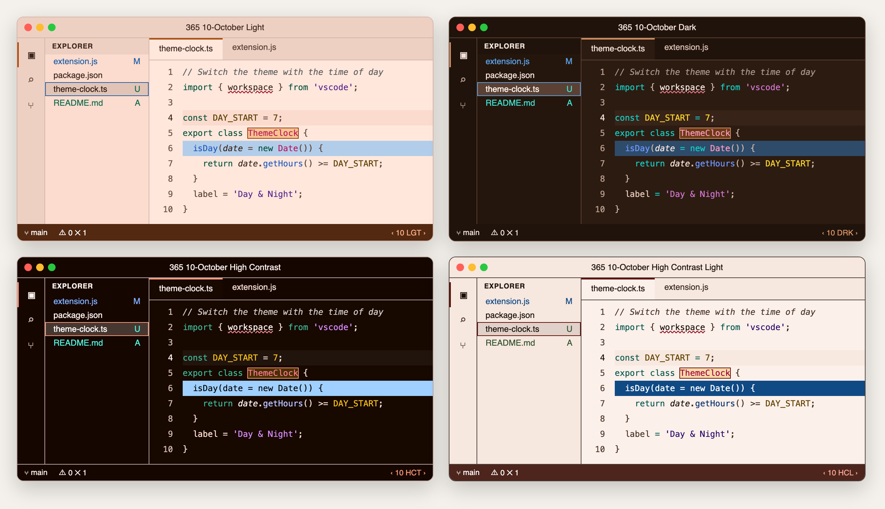

# 365 Day & Night Themes – Temas acessíveis do VS Code para todos os meses

**36 temas de cores para o Visual Studio Code: um tema claro, um escuro e um de alto contraste para cada mês do ano.** Alterne entre dia e noite com um clique ou deixe a extensão fazer isso por você. Cada tema é testado quanto à legibilidade (contraste WCAG) e ao daltonismo.

[](https://marketplace.visualstudio.com/items?itemName=mickaellherminez.365-daynight-vscode-theme-ext)
[](https://marketplace.visualstudio.com/items?itemName=mickaellherminez.365-daynight-vscode-theme-ext)
[](../LICENSE)

*Ler esta página em: [English](../README.md) · [Français](README_fr.md) · [Español](README_es.md) · [Deutsch](README_de.md) · [Русский](README_ru.md) · [中文](README_zh.md) · [日本語](README_ja.md) · [हिंदी](README_hi.md) · [العربية](README_ar.md)*



## Por que você vai gostar

- 🗓️ **Um visual novo a cada mês.** Neve e azul de inverno em janeiro, verde primavera em março, sol pleno em julho, cores de outono em outubro e clima de lareira em dezembro: seu editor acompanha as estações.
- ☀️🌙 **Dia e noite, sempre combinando.** Cada mês tem um tema claro para o dia, um escuro para a noite e um de alto contraste quando você precisa da máxima legibilidade. Outubro também tem um tema de alto contraste claro (High Contrast Light), um primeiro teste antes dos outros meses.
- 🔁 **Troca com um clique.** Um botão na barra de status alterna entre claro e escuro. O alto contraste está disponível por um comando.
- ⏰ **Modo automático opcional.** A extensão pode aplicar sozinha o tema do mês atual: claro de dia e escuro à noite.
- 👁️ **Confortável para os olhos e legível para todos.** Todo o texto atende aos níveis de contraste WCAG, e as cores de sintaxe continuam distintas para pessoas com daltonismo.
- 🖥️ **Temas cuidados.** Editor, barra lateral, abas, terminal, console de depuração, notificações e barra de status: tudo é estilizado, com mais de 480 cores por tema. O chat, os resultados de testes, os ícones de símbolos, o grafo do Git, o editor de mesclagem e o multi-diff também seguem a paleta do mês.

## Instalação

**Pelo VS Code:** abra a visão de Extensões (`Ctrl+Shift+X`, ou `Cmd+Shift+X` no Mac), pesquise **365 Day & Night Themes** e clique em **Instalar**.

**Pelo Marketplace:** [instalar 365 Day & Night Themes](https://marketplace.visualstudio.com/items?itemName=mickaellherminez.365-daynight-vscode-theme-ext).

**Pela linha de comando:**

```sh
code --install-extension mickaellherminez.365-daynight-vscode-theme-ext
```

Requer o Visual Studio Code 1.96 ou mais recente.

## Primeiros passos

1. Abra o seletor de temas: `Ctrl+K` e depois `Ctrl+T` (`Cmd+K` e depois `Cmd+T` no Mac).
2. Digite **365** para ver todos os temas, por exemplo `365 10-October Dark`.
3. Escolha um. Pronto!

Na primeira vez que você usa um tema 365, uma notificação oferece a troca automática: **Follow the clock** (seguir o horário: claro de dia, escuro à noite), **Follow my system** (seguir o modo claro ou escuro do seu sistema) ou **No thanks** (não, obrigado). Nada muda sem a sua escolha, e a pergunta é feita uma única vez. Depois de escolher, uma mensagem confirma o que está ativado, com um botão **Open Settings** para mudar os horários ou desativar. Para mudar de ideia depois, veja a seção sobre a troca automática abaixo.

O **botão da barra de status** (canto inferior direito: `LGT`, `DRK`, `HCT` ou `HCL`) alterna entre as versões clara e escura do mês atual. Para o alto contraste, execute `365: Apply High Contrast theme` na paleta de comandos. Em um tema de alto contraste, o botão alterna entre o alto contraste escuro (`HCT`) e o claro (`HCL`), para que um clique nunca saia do alto contraste. Um mês sem alto contraste claro volta ao tema claro: por enquanto só outubro o tem. Para sair do alto contraste, execute `365: Apply Light theme` ou `365: Apply Dark theme`. Você também pode passar o cursor sobre o botão e clicar no link **Light** ou **Dark**.

Para experimentar outro mês, clique nas setas ao redor dele (`‹ 10 DRK ›`). O número é o mês, de `01` a `12`, e as setas mantêm a variante: claro, escuro, alto contraste ou alto contraste claro. O alto contraste claro passa a alto contraste escuro em um mês que ainda não o tem. Depois de dezembro vem janeiro. Para voltar, execute `365: Back to the current month` na paleta de comandos. As setas e o número só aparecem com um tema 365. Passe o cursor sobre o botão para ver o nome completo do tema, com links para o alto contraste, para o alto contraste claro quando o mês o tem e para o mês atual. Em um tema de alto contraste, a dica mostra em vez disso links para Light e Dark.

## Os 12 meses


| Mês | Claro | Escuro | Alto contraste |
| --- | --- | --- | --- |
| Janeiro | Branco neve e azul de inverno | Noite azul-marinho iluminada de dourado | Preto e azul vivo |
| Fevereiro | Branco e verde, com um toque vermelho de Dia dos Namorados | Ardósia nórdica e geada | Azul-marinho e dourado |
| Março | Creme e verde primavera | Noite índigo | Verde-azulado escuro e vermelho-alaranjado |
| Abril | Creme e laranja de Páscoa | Ardósia azulada e dourado | Azul profundo e dourado |
| Maio | Branco luminoso e laranja | Noite oceânica com laranja | Azul-marinho e azul-celeste |
| Junho | Azul-celeste e tinta índigo | Noite azul iluminada de laranja | Preto e coral |
| Julho | Sol pleno: creme, marrom e laranja | Noite de verão inspirada no Solarized | Azul-marinho, laranja e dourado |
| Agosto | Creme quente e tinta índigo | Noite de ardósia com amarelo | Preto e verde neon |
| Setembro | Céu de volta às aulas e tinta marinha | Ardósia e verde-azulado | Preto e laranja vivo |
| Outubro | Creme outonal, laranja queimado e âmbar | Marrom escuro e brasa | Preto quente e âmbar |
| Novembro | Névoa, ardósia e azul-aço | Ardósia profunda, laranja e dourado | Preto e dourado |
| Dezembro | Geada e verde-azulado | Ao pé da lareira: ardósia e brasa | Noite de inverno e ciano gelado |

## Troca automática entre dia e noite

Quer que o editor acompanhe o relógio? Ative o modo automático:

1. Abra as configurações (`Ctrl+,` ou `Cmd+,`) e pesquise **365DayNight**.
2. Marque **365DayNight: Enable**.

Ou adicione isto ao seu `settings.json`:

```json
{
  "365DayNight.enable": true,
  "365DayNight.mode": "auto"
}
```

| Modo | O que faz |
| --- | --- |
| `auto` | Tema claro das 7h às 19h por padrão e tema escuro no restante do tempo. Esses horários podem ser alterados (veja abaixo) |
| `day` | Sempre o tema claro do mês atual |
| `night` | Sempre o tema escuro do mês atual |
| `system` | Segue a aparência clara, escura e de alto contraste do seu sistema (veja abaixo) |

A extensão também passa para o tema do mês seguinte no primeiro dia de cada mês.

Bom saber:

- **Você decide.** O modo automático vem desativado: a extensão nunca muda seu tema sem você pedir. Na primeira vez que você usa um tema 365, uma notificação pergunta uma única vez se você o quer.
- **Sua escolha é respeitada.** Se você escolher um tema manualmente, ele permanece até a próxima mudança de período (dia para noite ou novo mês).
- **Seu mês também permanece.** Se você escolher outro mês, com as setas ou o seletor de temas, o modo automático continua alternando claro e escuro nesse mês até o início do próximo mês real, mesmo depois de reiniciar. Para voltar antes, execute `365: Back to the current month`.
- **Alto contraste continua alto contraste.** Se você usa um tema de alto contraste, escuro ou claro, o modo automático só atualiza o mês, nunca a variante. Em um mês sem alto contraste claro, é usado o alto contraste escuro.

### Escolher seus horários

Por padrão, o tema claro começa às 7h e o escuro às 19h. Para alterar esses horários:

1. Abra as configurações (`Ctrl+,` ou `Cmd+,`) e pesquise **365DayNight**.
2. Defina **365DayNight: Day Start** e **365DayNight: Night Start** no formato HH:MM de 24 horas.

Ou adicione isto ao seu `settings.json`:

```json
{
  "365DayNight.dayStart": "08:30",
  "365DayNight.nightStart": "20:00"
}
```

- **Aplicado rapidamente.** Um novo horário vale cerca de 2 segundos depois que você para de digitar, mesmo que tenha escolhido um tema manualmente. Depois, o tema muda no minuto escolhido.
- **Depois da meia-noite.** Se o dia começar depois da noite, por exemplo `"20:00"` e `"06:00"`, o tema claro passa da meia-noite. Útil se você trabalha à noite.
- **Valores inválidos.** Um horário ilegível, como `"25:00"` ou `"7h"`, é substituído pelo valor padrão, e um aviso informa você uma vez. Dois horários iguais resultam em 7h e 19h.
- **Só no modo `auto`.** Os modos `day`, `night` e `system` ignoram esses horários.
- **Voltar para 7h e 19h.** Nas configurações, clique na engrenagem ao lado de cada horário e escolha **Reset Setting**, ou remova as duas linhas do seu `settings.json`.

### Seguir o seu sistema

Prefere seguir a aparência do seu sistema em vez do horário? Use o modo `system`:

1. Abra as configurações (`Ctrl+,` ou `Cmd+,`) e pesquise **365DayNight**.
2. Marque **365DayNight: Enable**.
3. Defina **365DayNight: Mode** como `system`.

Ou adicione isto ao seu `settings.json`:

```json
{
  "365DayNight.enable": true,
  "365DayNight.mode": "system"
}
```

| Seu sistema usa | Tema aplicado |
| --- | --- |
| Aparência clara | Tema claro do mês |
| Aparência escura | Tema escuro do mês |
| Alto contraste, com aparência escura | Tema de alto contraste do mês |
| Alto contraste, com aparência clara | O tema de alto contraste claro do mês. Os outros meses mantêm a sua configuração, por padrão o tema High Contrast Light do VS Code, até terem essa variante |

O botão neste modo:
- **Setas.** `‹` e `›` mudam o mês de todas as variantes. Esse mês permanece até o início do próximo mês real, mesmo após reiniciar. Para voltar antes, execute `365: Back to the current month`.
- **Botão central.** Seu sistema decide entre claro e escuro, então um clique apenas explica isso. Os comandos `365: Apply Light theme`, `365: Apply Dark theme`, `365: Apply High Contrast theme` e `365: Apply High Contrast Light theme` dizem o mesmo e não mudam nada.
- **Seletor de temas.** Escolher um tema 365 aplica o mês dele a todas as variantes. Escolher um tema de outro autor substitui apenas a variante em uso: ele permanece nos meses seguintes, e o botão não mostra setas nem mês. Clique no botão central para recuperar o tema 365.


- **O que muda.** O modo ativa `window.autoDetectColorScheme` e grava os temas do mês em `workbench.preferredLightColorTheme`, `workbench.preferredDarkColorTheme`, `workbench.preferredHighContrastColorTheme` e `workbench.preferredHighContrastLightColorTheme`. Este último só é gravado para um mês que tem um tema de alto contraste claro, e recupera o seu valor nos outros meses. `workbench.colorTheme` não muda.
- **Como voltar.** Desmarque **365DayNight: Enable** ou escolha outro modo. Suas configurações originais voltam, e as que não existiam são removidas novamente. Uma configuração que você alterou nesse meio-tempo mantém o seu valor.
- **Antes de desinstalar ou desativar a extensão.** Saia primeiro deste modo, pois depois uma extensão não pode mais restaurar nada. Se esqueceu, remova as cinco configurações acima do seu `settings.json`.
- **Alto contraste.** O VS Code dá prioridade ao alto contraste do seu sistema. Para ignorá-lo, desative `window.autoDetectHighContrast`: o modo nunca muda essa configuração.
- **Desativar a detecção.** Se você mesmo desativar `window.autoDetectColorScheme`, a extensão o deixa desativado e o botão funciona normalmente. Uma configuração de tema em um workspace continua tendo prioridade nesse workspace.
- **Sistemas operacionais.** Segundo a documentação do VS Code, a aparência clara ou escura é detectada no Windows e no macOS.

## Acessibilidade em primeiro lugar

Cada tema passa por uma auditoria de acessibilidade automatizada com mais de 250 verificações:

- **Texto legível:** o texto do editor e as cores de sintaxe atingem um contraste de pelo menos **4,5:1 (WCAG AA)** nos temas claros e escuros, e **7:1 (WCAG AAA)** nos de alto contraste.
- **Amigável para daltônicos:** as cores de sintaxe (palavras-chave, funções, strings, números, classes, comentários) e os alertas (erros, avisos, alterações do Git) são simulados em **protanopia, deuteranopia e tritanopia** para garantir que continuem distintos.
- **Não só cor:** comentários, parâmetros e atributos ficam em *itálico*, código obsoleto aparece ~~riscado~~ e código inválido, sublinhado.
- **Seleção visível em todo lugar:** a seleção de texto é bem visível no editor, no terminal e no console de depuração, sem se confundir com os resultados de busca.
- **Temas de alto contraste:** o texto selecionado fica preto sobre azul-claro (branco sobre azul-escuro no alto contraste claro), e todos os painéis têm bordas visíveis e um contorno de foco do teclado bem marcado.
- **Leitores de tela:** cada parte do botão da barra de status tem seu próprio rótulo falado, por exemplo “Next month: November”.

Alguma cor difícil de ler? [Abra uma issue](https://github.com/mickaellherminez/365-daynight-vscode-theme-ext/issues): comentários sobre acessibilidade são sempre bem-vindos.

## Comandos

Abra a paleta de comandos (`Ctrl+Shift+P` ou `Cmd+Shift+P`) e digite **365**:

| Comando | Ação |
| --- | --- |
| `365: Toggle between Light and Dark themes` | Alterna entre claro e escuro (igual ao botão da barra de status) |
| `365: Apply Light theme` | Aplica o tema claro do mês exibido |
| `365: Apply Dark theme` | Aplica o tema escuro do mês exibido |
| `365: Apply High Contrast theme` | Aplica o tema de alto contraste do mês exibido |
| `365: Apply High Contrast Light theme` | Aplica o tema de alto contraste claro do mês exibido. Um mês que ainda não o tem recebe seu tema de alto contraste escuro, e uma mensagem avisa |
| `365: Next month` | Aplica o tema do próximo mês, na mesma variante |
| `365: Previous month` | Aplica o tema do mês anterior, na mesma variante |
| `365: Back to the current month` | Aplica o tema do mês atual real, na mesma variante |

A extensão não define nenhum atalho de teclado por padrão. Para atribuir os seus, abra a lista de atalhos (`Ctrl+K Ctrl+S`, ou `Cmd+K Cmd+S` no Mac), digite **365**, clique duas vezes em um comando e pressione suas teclas.

## Configurações

| Configuração | Padrão | Descrição |
| --- | --- | --- |
| `365DayNight.enable` | `false` | Aplica automaticamente o tema do mês atual |
| `365DayNight.mode` | `auto` | `auto` (pelo horário), `day` (sempre claro), `night` (sempre escuro) ou `system` (segue seu sistema) |
| `365DayNight.dayStart` | `"07:00"` | Horário de início do tema claro no modo `auto`, no formato HH:MM |
| `365DayNight.nightStart` | `"19:00"` | Horário de início do tema escuro no modo `auto`, no formato HH:MM |
| `365DayNight.toggleIncludesHighContrast` | `false` | O botão da barra de status passa por todas as variantes: claro, escuro, alto contraste e depois alto contraste claro quando o mês o tem |

## Perguntas frequentes

**Como alternar o VS Code automaticamente entre um tema claro e um escuro?**
Instale a extensão e defina `"365DayNight.enable": true`. O tema claro é aplicado das 7h às 19h e o escuro à noite. Você pode alterar esses horários com `365DayNight.dayStart` e `365DayNight.nightStart`.

**O VS Code pode seguir o modo claro ou escuro do meu sistema com estes temas?**
Sim. Defina `"365DayNight.enable": true` e `"365DayNight.mode": "system"`. Seu sistema decide entre claro e escuro, e a extensão mantém os temas no mês atual.

**Existe um tema do VS Code amigável para daltônicos?**
Sim. Todos os temas são testados com simulações de protanopia, deuteranopia e tritanopia e usam itálico, sublinhado e riscado para que a informação nunca dependa só da cor.

**A extensão vai mudar meu tema sem perguntar?**
Não. O modo automático vem desativado. Sem ele, o tema só muda quando você escolhe um ou clica no botão da barra de status. Na primeira vez que você usa um tema 365, uma notificação o oferece, e nada muda sem a sua escolha.

**Posso usar um único tema, por exemplo October Dark?**
Claro. Escolha-o no seletor de temas (`Ctrl+K Ctrl+T`) e deixe o modo automático desativado.

**Para que servem os temas de alto contraste?**
Eles foram pensados para baixa visão, ambientes muito claros ou longas sessões de programação, com contraste máximo (AAA), bordas visíveis e um contorno de foco bem marcado. Cada mês tem uma versão escura. A clara, High Contrast Light, existe por enquanto para outubro, e os outros meses virão depois.

## Roteiro

Ideias e sugestões são bem-vindas nas [issues do GitHub](https://github.com/mickaellherminez/365-daynight-vscode-theme-ext/issues).

## Opiniões e contribuições

- ⭐ Gostou dos temas? Uma [avaliação no Marketplace](https://marketplace.visualstudio.com/items?itemName=mickaellherminez.365-daynight-vscode-theme-ext&ssr=false#review-details) ajuda outros desenvolvedores a encontrá-los.
- 🐞 Um bug, uma cor ilegível ou uma ideia: [abra uma issue](https://github.com/mickaellherminez/365-daynight-vscode-theme-ext/issues).
- 🛠️ Quer contribuir? Veja o [CONTRIBUTING.md](../CONTRIBUTING.md) (em inglês).

As notas de versão estão no [CHANGELOG](../CHANGELOG.md).

## Licença

[MIT](../LICENSE) © Mickaël Lherminez
