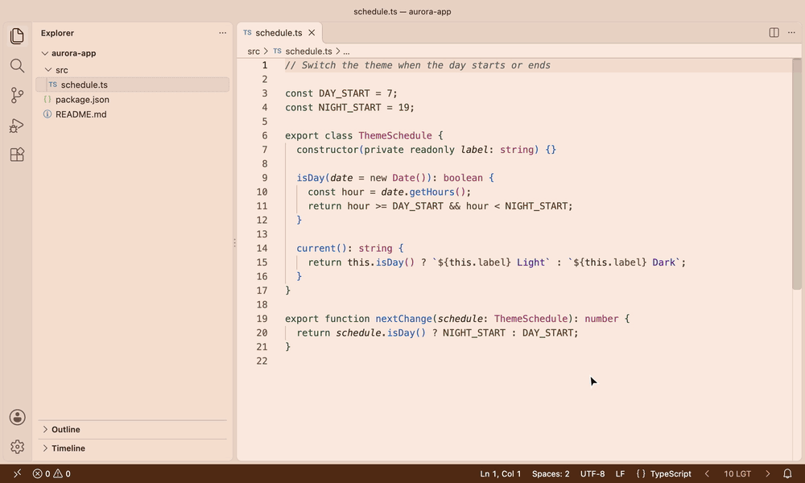
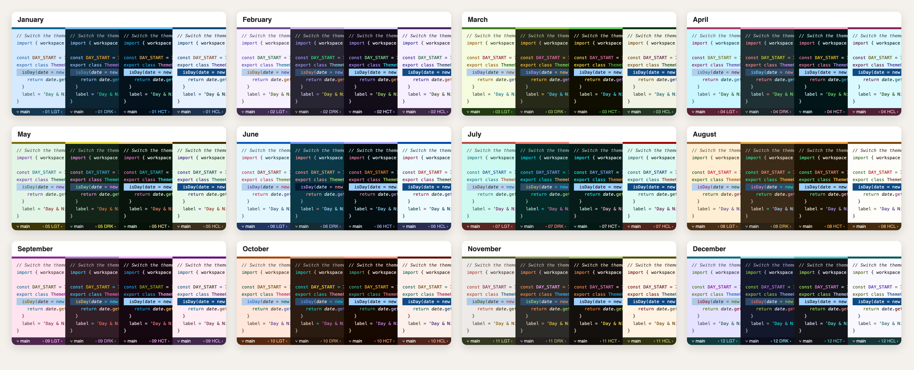
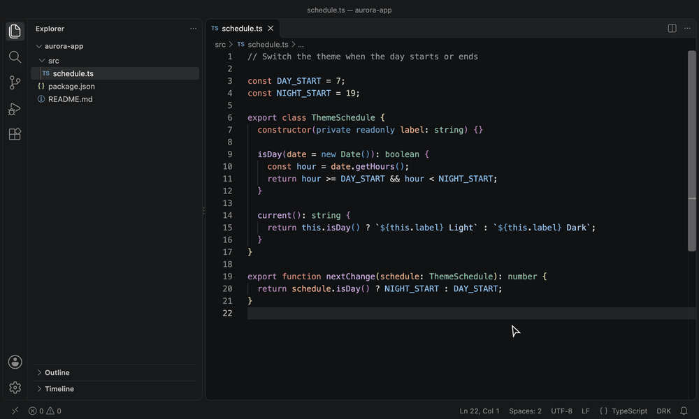
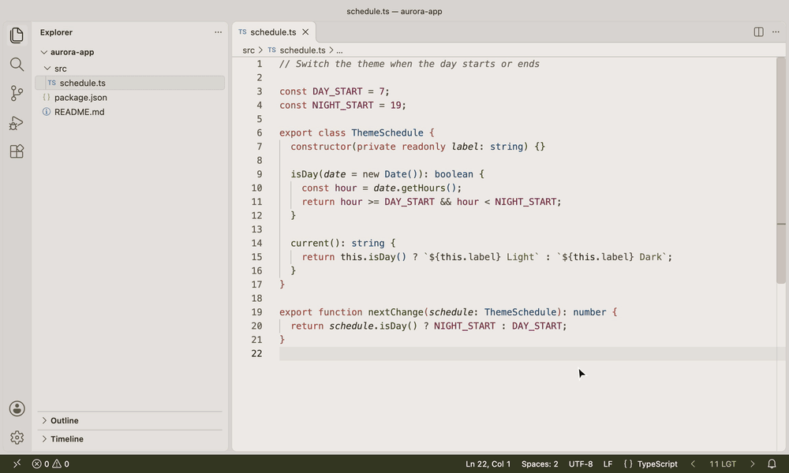

# 365 Day & Night – Monthly Accessible Themes

**让 VS Code 每个月都焕然一新：48 款无障碍主题，一键或自动在白天与夜晚之间切换。**

[](https://marketplace.visualstudio.com/items?itemName=mickaellherminez.365-daynight-vscode-theme-ext)
[](https://marketplace.visualstudio.com/items?itemName=mickaellherminez.365-daynight-vscode-theme-ext)
[](https://marketplace.visualstudio.com/items?itemName=mickaellherminez.365-daynight-vscode-theme-ext)
[](https://marketplace.visualstudio.com/items?itemName=mickaellherminez.365-daynight-vscode-theme-ext&ssr=false#review-details)
[](https://open-vsx.org/extension/mickaellherminez/365-daynight-vscode-theme-ext)
[](https://github.com/mickaellherminez/365-daynight-vscode-theme-ext/actions/workflows/ci.yml)
[](../LICENSE)

```sh
code --install-extension mickaellherminez.365-daynight-vscode-theme-ext
```

也可以从 [Marketplace](https://marketplace.visualstudio.com/items?itemName=mickaellherminez.365-daynight-vscode-theme-ext) 或 [Open VSX](https://open-vsx.org/extension/mickaellherminez/365-daynight-vscode-theme-ext) 安装。需要 VS Code 1.96 或更高版本。

*其他语言：[English](../README.md) · [Français](README_fr.md) · [Español](README_es.md) · [Deutsch](README_de.md) · [Português](README_pt.md) · [Русский](README_ru.md) · [日本語](README_ja.md) · [हिंदी](README_hi.md) · [العربية](README_ar.md)*



## 为什么选择它

### 🗓️ 每个月焕然一新

一月的霜、三月的新芽、七月的泻湖、十月的秋叶、十二月的极夜。 整个窗口都随季节变化：编辑器、侧边栏、标签页、终端、状态栏、聊天、Git 图和合并编辑器。

**依据：** 12 个月，每月 4 款主题（Light、Dark、High Contrast 和 High Contrast Light），每款主题超过 480 种颜色。[全部查看](#12-个月)。

### 👁️ 始终清晰易读

文本对比度在 Light 和 Dark 主题中至少为 4.5:1（WCAG AA），在 High Contrast 主题中至少为 7:1（WCAG AAA）。语法颜色、错误和 Git 更改在色觉障碍下仍可区分，注释、已弃用代码和无效代码还会用斜体、删除线或下划线来区分。

**依据：** 每款主题在每次发布前都必须通过 250 多项自动审核，[完整报告](AUDIT.md)列出了每款主题的结果和审核的局限。色觉障碍通过模拟进行检查，因此非常欢迎真实用户的反馈：[参加测试招募](https://github.com/mickaellherminez/365-daynight-vscode-theme-ext/issues/47)。

### 🌗 白天与夜晚，无需操心

点击状态栏按钮即可在 Light 和 Dark 之间切换。也可以让扩展按你选择的时间跟随时钟，或跟随系统外观。

**依据：** 自动模式默认关闭，只有在你需要时主题才会改变。你选择的月份和手动选择都会被保留。

## 12 个月



| 月份 | 氛围 | 月份 | 氛围 |
| --- | --- | --- | --- |
| 一月 | 霜 | 七月 | 泻湖 |
| 二月 | 薰衣草薄雾 | 八月 | 暖沙 |
| 三月 | 新芽 | 九月 | 葡萄采收 |
| 四月 | 春雨 | 十月 | 秋叶 |
| 五月 | 花开的草地 | 十一月 | 薄雾与林下 |
| 六月 | 长日 | 十二月 | 极夜 |

[完整指南](GUIDE_zh.md#12-个月)列出了每款主题的颜色。

## 如何使用

在 Mac 上，请用 `Cmd` 代替 `Ctrl`。

| 目标 | 操作 |
| --- | --- |
| **选择主题** | 按 `Ctrl+K`，再按 `Ctrl+T`，然后输入 **365** |
| **在 Light 和 Dark 之间切换** | 点击右下角状态栏中的 `LGT` 或 `DRK` |
| **更改月份** | 点击月份两侧的箭头：`‹ 10 DRK ›` |
| **回到当前月份** | 在命令面板（`Ctrl+Shift+P`）中运行 `365: Back to the current month` |
| **使用高对比度** | 运行 `365: Apply High Contrast theme` 或 `365: Apply High Contrast Light theme` |
| **退出高对比度** | 运行 `365: Apply Light theme` 或 `365: Apply Dark theme` |
| **开启自动模式** | 打开设置（`Ctrl+,`），搜索 **365DayNight** 并勾选 **Enable** |
| **添加键盘快捷键** | 按 `Ctrl+K`，再按 `Ctrl+S`，输入 **365**，双击命令并按下你的按键。默认没有设置快捷键 |

### 自动模式

第一次使用 365 主题时，扩展会询问一次是否需要自动切换。除非你做出选择，否则什么都不会改变。



之后你可以选择时间。新时间会在你停止输入约 2 秒后生效。



**➡️ [完整指南](GUIDE_zh.md)详细介绍了所有内容：**[自动模式及其时间](GUIDE_zh.md#白天与夜晚自动切换)、[跟随系统](GUIDE_zh.md#跟随系统)、[全部命令](GUIDE_zh.md#命令)和[全部设置](GUIDE_zh.md#设置)。

## 无障碍

- **清晰的文本：** Light 和 Dark 主题达到 WCAG AA，High Contrast 主题达到 AAA。
- **色觉障碍：** 针对红色盲、绿色盲和蓝色盲模拟语法颜色和警报。
- **不只依赖颜色：** 注释、参数和属性使用*斜体*，已弃用代码使用~~删除线~~，无效代码使用下划线。
- **键盘和屏幕阅读器：** High Contrast 主题具有醒目的焦点轮廓，状态栏按钮的每个部分都有自己的朗读标签。

有难以阅读的地方？[告诉我们](https://github.com/mickaellherminez/365-daynight-vscode-theme-ext/issues/new/choose)。查看[更多详情](GUIDE_zh.md#无障碍优先)和[完整审核报告](AUDIT.md)。

## 1.0 的全新外观

1.0.0 版本重新设计了所有主题，你选择的主题、设置和快捷键都会保留。更喜欢以前的外观？[查看如何回退](GUIDE_zh.md#全新外观以及如何回退)。

## 常见问题

**如何让 VS Code 在浅色和深色主题之间自动切换？**
安装扩展并设置 `"365DayNight.enable": true`。7:00 至 19:00 使用浅色主题，夜间使用深色主题。 你可以通过 `365DayNight.dayStart` 和 `365DayNight.nightStart` 更改这些时间。

**VS Code 能否使用这些主题跟随系统的浅色或深色模式？**
可以。设置 `"365DayNight.enable": true` 和 `"365DayNight.mode": "system"`。浅色和深色由系统决定，扩展会让主题保持在当前月份。

**有适合色盲用户的 VS Code 主题吗？**
有。全部主题都经过红色盲、绿色盲和蓝色盲模拟测试，注释、已弃用代码和无效代码还会用斜体、删除线或下划线来区分。

**扩展会在未经询问的情况下更改我的主题吗？**
不会。自动模式默认关闭。未开启时，只有在你选择主题或点击状态栏按钮时主题才会改变。 首次使用 365 主题时，会有一条通知提供该功能，除非你做出选择，否则什么都不会改变。

**我可以只使用一款主题吗，比如 October Dark？**
当然可以。在主题选择器（`Ctrl+K Ctrl+T`）中选择它，并保持自动模式关闭即可。

**高对比度主题有什么用？**
它们专为低视力、强光环境或长时间编码而设计，提供最高对比度（AAA）、可见边框和醒目的焦点轮廓。每个月都有两款：深色版本，以及适合明亮环境的浅色版本 High Contrast Light。

**如何抢先试用新版本？**
当有预发布版本时，在扩展视图中打开扩展页面，点击 **Switch to Pre-Release Version**（切换到预发布版本）。VS Code 随后会安装预发布版本及其更新。要回到正式版本，请在同一页面点击 **Switch to Release Version**。欢迎在 [GitHub Issues](https://github.com/mickaellherminez/365-daynight-vscode-theme-ext/issues) 中反馈预发布版本的问题。我们正在[招募测试者](https://github.com/mickaellherminez/365-daynight-vscode-theme-ext/issues/47)，并提供了一份简短的检查清单。

## 喜欢这些主题？

⭐ 在 [Marketplace 上留下评价](https://marketplace.visualstudio.com/items?itemName=mickaellherminez.365-daynight-vscode-theme-ext&ssr=false#review-details)，帮助其他开发者发现它们。

发现错误、难以阅读的颜色或有新想法？请[提交 issue](https://github.com/mickaellherminez/365-daynight-vscode-theme-ext/issues/new/choose)。想要贡献？请参阅 [CONTRIBUTING.md](../CONTRIBUTING.md)。发行说明位于 [CHANGELOG](../CHANGELOG.md)。

[MIT](../LICENSE) © Mickaël Lherminez
